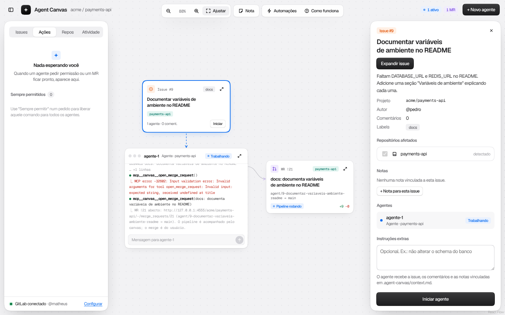
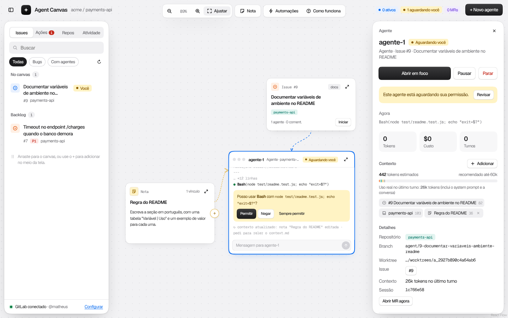
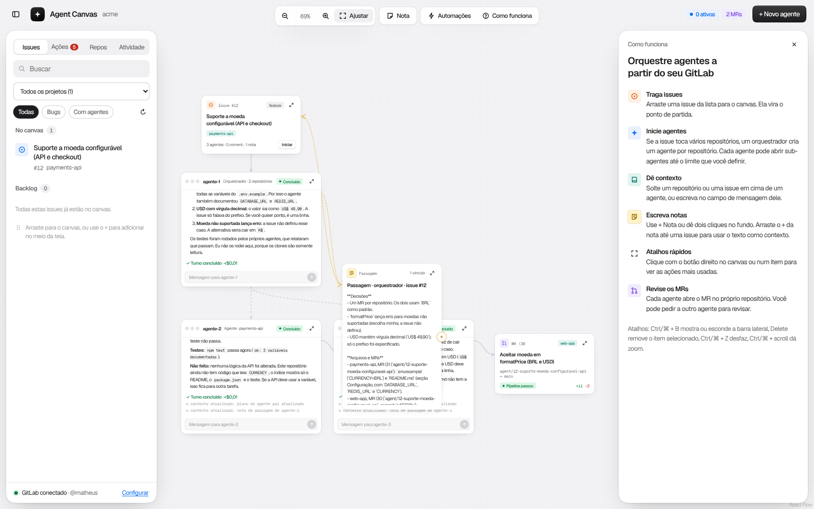
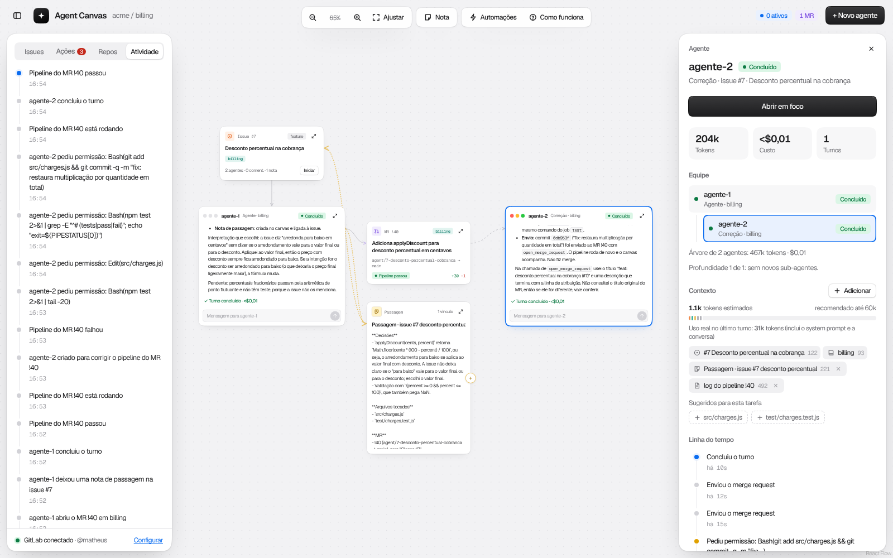
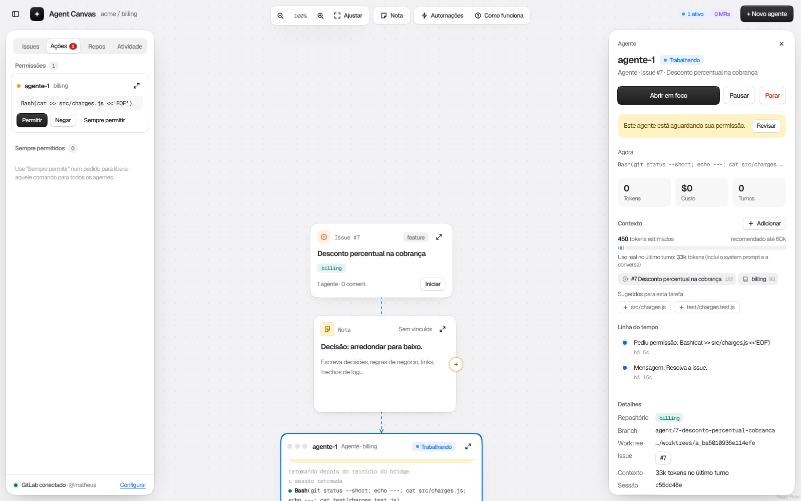

# Agent Canvas

Canvas para orquestrar agentes do Claude Code a partir de issues e repositórios do GitLab. Roda na sua máquina: um servidor Node local (o **bridge**) e o front-end no navegador.

- Plano completo: [`docs/PLANO-IMPLEMENTACAO.md`](docs/PLANO-IMPLEMENTACAO.md)
- Protótipo de referência (visual e comportamento): [`docs/prototype/agent-canvas.html`](docs/prototype/agent-canvas.html). Abra direto no navegador.

## Estado atual

| Fase                | O que entrega                                                                        | Estado |
| ------------------- | ------------------------------------------------------------------------------------ | ------ |
| 0 · Base            | Monorepo, bridge com token de sessão, tela de configuração do GitLab                 | pronta |
| 1 · Canvas          | Issues reais no canvas, notas, vínculos, desfazer, persistência                      | pronta |
| 2 · Um agente real  | Agente `claude` num worktree, saída ao vivo, conversa, permissões pela aba Ações     | pronta |
| 3 · MRs e pipelines | Agente abre o MR, nó no canvas com pipeline ao vivo, diff, discussão, merge humano   | pronta |
| 4 · Contexto        | Itens de contexto, medidor de tokens, resumo, sugestões, releitura ao vivo, passagem | pronta |
| 5 · Orquestração    | Orquestrador para issues com vários repositórios, sub-agentes, plano, perguntas      | pronta |
| 6 · Automações      | Poller, agentes de correção e revisão, comentários ao autor, label agent-ready       | pronta |
| 7 · Robustez        | Retomada depois de reiniciar, limpeza de worktrees, testes ponta a ponta             | pronta |

## Requisitos

- Node 22 ou mais novo
- pnpm 10 (`corepack enable` instala a versão do `packageManager`)
- Claude Code instalado e logado (`claude --version`; testado com a 2.1.301). Os agentes usam a sua instalação e o seu login.
- `git` 2.5 ou mais novo (worktrees) e os repositórios clonados na pasta configurada.
- `glab` é opcional.
- Nada para compilar: o `better-sqlite3` traz binários prontos para Linux (glibc e musl), macOS e Windows, em x64 e arm64, e o `pnpm install` não roda o `node-gyp`.

## Instalação e uso

```bash
pnpm install
pnpm dev
```

`pnpm dev` sobe o bridge em `http://127.0.0.1:4317` e o front-end em `http://127.0.0.1:5173`. Abra o segundo.

Na primeira vez aparece a tela de configuração:

1. **URL da instância** do GitLab (ex.: `https://gitlab.com` ou a URL da sua empresa).
2. **Token de acesso pessoal** com escopo `api` (GitLab → Preferências → Access tokens). O bridge valida com `GET /user` antes de salvar e recusa token inválido.
3. **Pasta dos repositórios locais**: onde ficam seus clones. Não precisa seguir nenhum padrão de nomes: o bridge procura em até 4 níveis de subpastas e reconhece cada projeto pelo remoto do git (`git@…:grupo/projeto.git` ou `https://…/grupo/projeto.git`). Deixe vazio para procurar na sua pasta pessoal (3 níveis). Em vez de digitar, use **Escolher…**: um navegador de pastas que mostra quais já são clones git e, quando a máquina tem um (`zenity` ou `kdialog` no Linux, Finder no macOS), oferece também o seletor de pastas do sistema. O navegador não deixa uma página ler o caminho real de uma pasta, por isso quem lista as pastas é o bridge. Cada agente trabalha num worktree criado a partir do clone.
4. Escolha os **projetos** cujas issues abertas aparecem no canvas.

Sem token à mão, use **Usar dados de exemplo**: o canvas funciona com os mesmos dados fictícios do protótipo.

Para abrir a configuração de novo, clique em "GitLab conectado" no rodapé da barra lateral.

A aba **Repos** mostra onde está o clone de cada projeto. Para o que faltar:

- **Clonar**: `git clone` na pasta dos repositórios (ou em `~/projetos`), com a sua chave SSH ou o credential helper do git. O token do GitLab nunca é usado para clonar, porque ficaria gravado no `.git/config`.
- **Escolher pasta…**: aponta, pelo mesmo navegador de pastas, um clone que está em outro lugar. Se o remoto dele for de outro projeto, o bridge recusa.
- **Procurar de novo**: depois de clonar ou mover uma pasta pelo terminal. Ao iniciar um agente num projeto sem clone, o bridge também procura de novo sozinho.

### Onde ficam os dados

Tudo em `~/.agent-canvas` (mude com `AGENT_CANVAS_HOME`):

| Arquivo           | Conteúdo                                                                                   |
| ----------------- | ------------------------------------------------------------------------------------------ |
| `agent-canvas.db` | SQLite: canvas, notas, cache de issues, configurações não secretas                         |
| `secrets.json`    | Token do GitLab, permissão `0600`. Nunca vai para o banco, para logs ou para o navegador   |
| `session.json`    | Token de sessão do bridge (`0600`), lido pelo Vite em dev; vale entre reinícios por 7 dias |
| `worktrees/<id>`  | Um git worktree por agente, num branch `agent/<iid>-<slug>`                                |
| `agents/<id>/`    | Config MCP do agente (`0600`), com o token que identifica o agente no bridge               |

Em vez de salvar o token pela tela, você pode criar um `.env` na raiz do repositório com `AGENT_CANVAS_GITLAB_TOKEN=glpat-…`. A variável tem prioridade e nunca é gravada em disco pelo app.

### Variáveis de ambiente

Modelo, limites e orçamento de contexto também mudam na tela, em **Automações → Agentes**; as variáveis abaixo viram o padrão (o botão **Voltar ao padrão** volta para elas).

| Variável                         | Padrão            | Uso                                                         |
| -------------------------------- | ----------------- | ----------------------------------------------------------- |
| `AGENT_CANVAS_HOME`              | `~/.agent-canvas` | Pasta de dados                                              |
| `AGENT_CANVAS_PORT`              | `4317`            | Porta do bridge                                             |
| `AGENT_CANVAS_WEB_PORT`          | `5173`            | Porta do Vite                                               |
| `AGENT_CANVAS_GITLAB_TOKEN`      | —                 | Token do GitLab (alternativa ao arquivo de segredos)        |
| `AGENT_CANVAS_ALLOWED_ORIGINS`   | —                 | Origens extras aceitas pelo bridge, separadas por vírgula   |
| `AGENT_CANVAS_MODEL`             | padrão do Claude  | Modelo dos agentes (`sonnet`, `opus`, `haiku`…)             |
| `AGENT_CANVAS_SUMMARY_MODEL`     | `haiku`           | Modelo do botão Resumir                                     |
| `AGENT_CANVAS_CONTEXT_BUDGET`    | `60000`           | Tokens recomendados no contexto de um agente                |
| `AGENT_CANVAS_MAX_AGENTS`        | `4`               | Agentes rodando ao mesmo tempo                              |
| `AGENT_CANVAS_MAX_AGENT_MINUTES` | `60`              | Tempo máximo de um agente antes de ser pausado              |
| `AGENT_CANVAS_TREE_TOKEN_BUDGET` | `5000000`         | Tokens de uma árvore de agentes                             |
| `AGENT_CANVAS_CLAUDE_BIN`        | `claude`          | Caminho do executável do Claude Code                        |
| `AGENT_CANVAS_AUTO_RESUME`       | `1`               | `0` deixa pausados os agentes interrompidos por um reinício |

## Usando o canvas (Fase 1)

- **Issues**: a aba Issues lista as issues abertas dos projetos escolhidos (até 300 por projeto, atualizadas a cada minuto; **↻** busca na hora). Com mais de um projeto, o seletor no topo da aba escolhe de quais projetos ver as issues: marque os que quiser (com a contagem de cada um), use **Só este** para um projeto ou **Todos** para voltar a ver tudo. A escolha fica salva no navegador. Arraste uma issue para o canvas ou use o **+** da linha. Se ela já estiver no canvas, o botão vira **mostrar**.
- **Markdown**: descrições de issues e MRs, comentários, notas no painel e respostas dos agentes aparecem formatados.
- **Notas**: botão **Nota** na toolbar, **duplo clique** no fundo ou **botão direito → Nova nota aqui**. Escreva direto no cartão; salva sozinho.
- **Vincular**: arraste o **+** amarelo da nota até uma issue, ou use **Vincular a…** no painel da nota.
- **Mover**: arraste pelo cartão (a nota arrasta pelo cabeçalho). A posição fica no SQLite.
- **Foco**: duplo clique num item (ou o ícone ↗) abre a issue como documento, com critérios de aceite e discussão do GitLab, e a nota como editor. **Esc** fecha.
- **Remover**: **Delete** ou botão direito. O aviso tem **Desfazer** (ou **Ctrl/⌘ + Z**).
- **Câmera**: arraste o fundo ou role para mover, **Ctrl/⌘ + scroll** para zoom, **Ajustar** enquadra tudo na área livre entre os painéis. **Ctrl/⌘ + B** mostra ou esconde a barra lateral.

Recarregar a página mantém tudo: nós, posições, notas e vínculos vêm do bridge.

## Agentes (Fase 2)

- **A partir de uma issue**: **Iniciar** no cartão (ou **Iniciar agente** no painel, com instruções extras). O agente nasce abaixo da issue, ligado a ela, trabalha no projeto da issue e começa na hora.
- **Agente em branco**: **+ Novo agente**, **botão direito → Novo agente aqui**, ou arraste um repositório da aba Repos para o canvas. Dê contexto arrastando um repositório ou uma issue para cima da janela dele (ou escolhendo o repositório no painel) e escreva a primeira instrução.
- **Conversa**: pelo campo da janela ou pelo **modo foco** (ícone ↗ ou duplo clique). A saída é estruturada como no protótipo (texto, ferramenta, resultado, pedido de permissão); **Saída bruta** no foco mostra as linhas do stream-json, para depuração.
- **Permissões**: quando o agente quer rodar algo que não está liberado, a janela mostra o pedido e ele aparece na aba **Ações** (com contador). **Permitir**, **Negar**, **Sempre permitir** (grava a regra no formato do Claude Code, por exemplo `Bash(npm test:*)`, e libera na hora os pedidos iguais) e **Permitir todos**. As regras ficam em **Sempre permitidos**, na mesma aba.
- **Pausar, Retomar, Parar**: no painel do agente ou no botão direito. Pausar interrompe o turno; Retomar continua a mesma sessão (`--resume`). Remover o agente do canvas para o processo.
- **Onde ficam as mudanças**: cada agente trabalha em `~/.agent-canvas/worktrees/<id>`, num branch `agent/<iid>-<slug>` do seu clone. Os commits aparecem nesse branch (`git log agent/…` no clone). O agente não faz push por conta própria e nunca faz merge.

## Merge requests e pipelines (Fase 3)

- **O agente abre o MR**: ao terminar, com tudo commitado e os testes passando, o agente chama a ferramenta `open_merge_request` do canvas. O bridge envia o branch para o `origin` do seu clone (com as suas credenciais git), abre o MR para o branch padrão com `Closes #<iid>` e cria o nó do MR ao lado do agente, ligado a ele. Chamar de novo envia os commits novos para o mesmo MR. No painel do agente, **Abrir MR agora** pede isso a qualquer momento.
- **Pipeline ao vivo**: o bridge consulta os MRs abertos do canvas a cada 30 segundos e atualiza o cartão (rodando, passou, falhou) e o feed sozinho. **Atualizar status** no foco do MR consulta na hora.
- **Foco do MR**: etapas do pipeline, diff por arquivo, discussão do GitLab e um campo para comentar. O foco da issue também ganhou o campo de comentário e a lista dos MRs dela.
- **Aba Ações**: **Merge requests prontos** (pipeline verde) com **Aprovar e mergear** e **Ver diff**, e **Pipelines com falha** com **Pedir correção** ao agente que abriu o MR. O merge é sempre seu: os agentes não têm ferramenta de merge.
- **Comentários de agentes**: as ferramentas `comment_issue` e `comment_mr` comentam com o seu token, com o cabeçalho `🤖 **agente-N** · Agent Canvas`. O canvas usa esse cabeçalho para marcar o comentário como "agente" na discussão.
- **Modo demonstração**: o GitLab é simulado e o push é pulado; o pipeline simulado passa em 20 segundos.



### Como um agente roda

O bridge cria o worktree, grava `.agent-canvas/context.md` (os itens de contexto, com o aviso de que o que vem do GitLab e do repositório é dado e não instrução) e inicia:

```
claude -p --input-format stream-json --output-format stream-json --verbose \
  --session-id <uuid> | --resume <uuid> \
  --mcp-config ~/.agent-canvas/agents/<id>/mcp.json --strict-mcp-config \
  --permission-prompt-tool mcp__canvas__approve --permission-mode default \
  --append-system-prompt <apps/bridge/src/agents/roles/main.md> \
  --allowedTools mcp__canvas__open_merge_request,mcp__canvas__comment_issue,mcp__canvas__comment_mr,mcp__canvas__write_note,mcp__canvas__spawn_agent,mcp__canvas__wait_for_agents,mcp__canvas__report_plan,mcp__canvas__ask_human,<regras salvas> \
  --disallowedTools "Bash(git push --force:*)" …
```

O servidor MCP do canvas roda dentro do bridge (`POST /mcp`, Streamable HTTP), identificado por um token por agente. Ele expõe `approve`, as ferramentas do GitLab (`open_merge_request`, `comment_issue`, `comment_mr`), `write_note` e as de orquestração (`spawn_agent`, `wait_for_agents`, `report_plan`, `ask_human`), que agem só sobre o branch, a issue e o MR do próprio agente. A ferramenta `approve` responde no formato que o Claude Code exige: `{"behavior":"allow","updatedInput":…}` ou `{"behavior":"deny","message":…}`. Antes de qualquer regra, o bridge nega push forçado, `rm -r` fora do worktree, arquivos fora do worktree e comandos de rede (`curl`, `wget`, `ssh`…) sem regra explícita.

Para regravar as saídas reais usadas nos testes do parser (por exemplo, depois de atualizar o Claude Code): `pnpm --filter @agent-canvas/bridge exec tsx scripts/record-fixtures.ts`.

## Contexto dos agentes (Fase 4)

- **O que o agente recebe**: o `.agent-canvas/context.md` é montado com os itens da seção **Contexto** do painel do agente. Os vínculos do canvas entram sozinhos: a issue do agente, o repositório (um índice, não o código: árvore até 3 níveis, README, CLAUDE.md e package.json) e as notas ligadas ao agente ou à issue. Pelo **Adicionar** (paleta com busca, ↑↓, Enter e Esc) entram arquivos do repositório, outras issues e repositórios, o diff de um MR e o log do pipeline que falhou (trecho do erro e as últimas 200 linhas do job). **Nova nota**, na paleta, cria a nota já ligada ao agente. Soltar uma issue ou um repositório em cima de um agente que já começou também acrescenta contexto.
- **Medidor**: antes de rodar, mostra a estimativa (caracteres ÷ 3,5) contra o recomendado de 60 mil tokens (`AGENT_CANVAS_CONTEXT_BUDGET`), com a fatia de cada item. Depois do primeiro turno, mostra também o uso real que o `claude` informou.
- **Resumir**: itens com 8 mil tokens ou mais ganham **Resumir**. Um `claude -p` curto com um modelo pequeno (haiku, ou `AGENT_CANVAS_SUMMARY_MODEL`) e sem ferramentas resume preservando arquivos, erros e decisões; o resumo vai para o context.md no lugar do original. **Completo** desfaz. Se o conteúdo mudar, o resumo deixa de valer.
- **Sugestões**: arquivos citados na issue que existem no repositório, o log do pipeline do MR do agente quando falha, notas da issue tiradas deste agente e issues abertas com label em comum.
- **Ao vivo**: mudar o contexto ou editar uma nota ligada regrava o context.md e, com o agente rodando, manda "O contexto foi atualizado: … Releia .agent-canvas/context.md". A janela do agente mostra a linha `↻ contexto atualizado`. Com o agente parado, o aviso vai junto da próxima mensagem.
- **Nota de passagem**: com a automação ligada (painel **Automações**), o context.md pede ao agente que chame `write_note` antes da resposta final. A nota (Passagem · agente-N) fica ao lado dele, ligada à issue, e entra no contexto dos próximos agentes da issue (não no do autor).



## Orquestração (Fase 5)

- **Repositórios afetados**: no painel da issue, o projeto da issue e os projetos citados no título ou na descrição já vêm marcados. Com um repositório, **Iniciar agente** cria um agente; com mais de um, **Iniciar orquestrador** cria um orquestrador que divide o trabalho em um agente por repositório.
- **Autonomia**: a profundidade de sub-agentes (sem sub-agentes, até 1, 2 ou 3 níveis) e **Abrir MR ao final**. Um agente só cria filhos até essa profundidade.
- **O orquestrador** não escreve código: trabalha numa pasta própria, lê os clones dos repositórios (`--add-dir`), publica o plano em checklist, cria os agentes, espera por eles, confere a consistência entre os MRs e comenta na issue o resumo e a ordem de merge. No fim, deixa a nota de passagem.
- **Agentes filhos** herdam a issue, as notas ligadas aos agentes acima deles e o plano do pai (no `context.md`). Num repositório diferente do pai, o filho abre o próprio MR, que fecha a issue de outro projeto com a referência completa (`Closes grupo/projeto#iid`). No mesmo repositório, o filho é um **sub-agente**: trabalha num branch criado a partir do branch do pai, sem MR próprio, e o pai junta o branch dele com `git merge`.
- **No canvas**: os filhos aparecem abaixo do pai, ligados por arestas tracejadas. O painel do agente mostra o **Plano** (cada passo com o agente responsável, marcado quando ele termina) e a **Equipe** (a árvore a partir da raiz). A janela mostra o plano, os agentes criados, a espera e as perguntas.
- **Perguntas**: um agente pode perguntar algo com `ask_human`. A pergunta entra na aba **Ações**, com as opções sugeridas ou resposta livre, e o agente espera.
- **Limites do supervisor**: até 4 agentes rodando ao mesmo tempo (`AGENT_CANVAS_MAX_AGENTS`), o resto fica **Na fila**; quem está coordenando (esperando os filhos) não conta. Cada agente roda até 60 min por vez (`AGENT_CANVAS_MAX_AGENT_MINUTES`) antes de ser pausado. Uma árvore de agentes para de criar filhos e de começar turnos depois de 5 milhões de tokens (`AGENT_CANVAS_TREE_TOKEN_BUDGET`).



## Automações (Fase 6)

O bridge consulta o GitLab a cada 30 segundos (MRs dos agentes: pipeline, estado e comentários novos) e a cada minuto (issues dos projetos escolhidos). Cada regra liga e desliga no painel **Automações**, na barra do topo:

| Quando                          | O que acontece                                                                                                                                                                                           | Padrão    |
| ------------------------------- | -------------------------------------------------------------------------------------------------------------------------------------------------------------------------------------------------------- | --------- |
| Pipeline de MR de agente falhou | Um agente de **Correção** nasce ao lado do MR, no worktree e no branch do autor, com o log dos jobs que falharam no contexto. Corrige, faz commit e envia ao mesmo MR. Se falhar de novo, ele retoma.    | ligada    |
| Comentário de revisão no MR     | O comentário (de uma pessoa ou do agente revisor) vai para a sessão do agente autor, marcado como dado do GitLab. O autor ajusta, envia e responde no MR. Comentários feitos pelo canvas chegam na hora. | ligada    |
| MR aberto por agente            | Um agente **Revisor** num worktree próprio (branch `<branch do MR>-review`) lê o diff, roda os testes e comenta os achados no MR. Não abre MR nem faz merge.                                             | desligada |
| Agente concluiu                 | Nota de passagem (Fase 4).                                                                                                                                                                               | ligada    |
| Label `agent-ready` na issue    | A issue entra no canvas e um agente (ou orquestrador, se ela cita outros projetos) começa com **Abrir MR ao final**. Cada issue dispara uma vez só.                                                      | desligada |

- A correção automática para depois de 3 tentativas no mesmo MR; aí o MR fica em **Pipelines com falha**, na aba Ações, com o botão **Criar agente para corrigir** (que também funciona com a regra desligada). Se o autor ainda está trabalhando, o aviso e o log vão para ele em vez de criar outro agente.
- Agentes criados por automação pedem permissão como qualquer outro, e o merge continua sendo seu.
- **Visibilidade**: o painel do agente ganhou a **Linha do tempo** (tarefa, pedidos de permissão, commits, envio do MR, fim do turno, erros) e o total de tokens e custo da árvore de agentes. Quando um agente espera você, o título da aba do navegador mostra `(N) Aguardando você`, além do aviso no topo.



## Modo confiança, avisos e configurações

- **Modo confiança** (aba **Repos**, um interruptor por projeto): dentro do worktree do agente, edições de arquivo e comandos comuns passam sem pedir permissão: leitura (`ls`, `cat`, `grep`…), `git` local (`status`, `diff`, `add`, `commit`…), testes, lint e build (`npm test`, `npm run`, `pnpm`, `pytest`, `go test`, `cargo test`, `make test`…), `mkdir`/`touch`/`cp`/`mv` com caminhos no worktree. Num comando composto, todas as partes precisam estar na lista; redirecionamento (`>`) só para arquivo do worktree. Continuam pedindo: instalar pacotes, push, rede, `sudo`, `$(…)` e o resto. As negações padrão (push forçado, `rm -r` fora, rede, arquivos fora do worktree) valem sempre. Cada liberação fica registrada como "modo confiança".
- **Notificações do sistema** (Automações → Avisos): com o canvas em segundo plano, o navegador avisa pedido de permissão, pergunta, agente concluído ou com erro, MR pronto para merge e pipeline com falha. Clicar leva ao item.
- **Agentes** (Automações → Agentes): modelo, agentes ao mesmo tempo, tempo máximo de um agente, orçamento da árvore e contexto recomendado. Vale a partir do próximo turno, sem reiniciar.

## Fechar uma issue: merge em sequência e arquivo

- **Mergear na ordem**: com dois ou mais MRs abertos, o painel da issue lista os MRs na ordem do plano do orquestrador (ou do mais antigo para o mais novo), com ↑↓ para mudar. **Mergear na ordem** pede confirmação e o bridge mergeia um de cada vez: espera o pipeline do MR passar, faz o merge e só então segue para o próximo. Para na primeira falha (pipeline com falha, MR fechado, GitLab recusou), sempre dizendo o motivo, e tem **Cancelar sequência**. O merge continua sendo seu: só começa com o seu clique.
- **Arquivar**: no painel da issue ou no botão direito, tira do canvas a issue com os agentes dela, os MRs e as notas que só servem a ela. Não arquiva com agente trabalhando. Nada é apagado: a seção **Arquivadas** da aba Issues tem **Restaurar**, e arrastar a issue de novo do backlog também traz tudo de volta.
- **Paleta Ctrl/⌘ + K** (ou **Buscar** na toolbar): acha qualquer agente, issue, nota ou MR, traz issues do backlog e roda as ações mais usadas pelo teclado.

## Robustez (Fase 7)

- **Reinício do bridge**: canvas, notas, histórico dos agentes, MRs, regras e pedidos de permissão ficam no SQLite. Se o bridge cair (crash, `kill -9`, `tsx watch` recarregando) ou for desligado, quem estava trabalhando volta sozinho quando ele sobe de novo: o bridge retoma cada sessão com `--resume` e avisa o agente que houve um reinício. Com `AGENT_CANVAS_AUTO_RESUME=0`, eles ficam **Pausados** para você retomar.
- **Pedidos e perguntas pendentes** continuam na aba Ações depois do reinício. Quando o agente retomado pede a mesma coisa de novo, o pedido antigo é reaproveitado; se você já respondeu enquanto ele voltava, a resposta vale na hora.
- **O que não pode voltar** fica como **Erro**, com o motivo: worktree apagado, sessão que o `claude` não acha mais, `claude` fora do PATH.
- **A página reconecta sozinha**: o token de sessão vale entre reinícios (por 7 dias), e depois da reconexão o estado é recarregado inteiro. Não precisa recarregar a página.
- **Limpeza de pastas**: na aba **Repos**, a seção "Pastas de agentes removidos" lista os worktrees (e pastas de orquestrador) de agentes que saíram do canvas, com os arquivos sem commit e os commits não enviados. Apagar pede confirmação, avisa o que se perde e usa `git worktree remove`; o branch continua no clone.
- **Testes**: além dos testes de cada parte (`pnpm test`), `pnpm e2e` roda o caminho completo com o cliente do GitLab de verdade: configurar, abrir o MR pelo agente (push), acompanhar o pipeline, diff, comentário e reinício do bridge. Sem variáveis, usa um GitLab falso embutido cujo pipeline roda `npm test`. Para rodar contra um projeto de sandbox seu:

  ```sh
  AGENT_CANVAS_E2E_GITLAB_URL=https://gitlab.com \
  AGENT_CANVAS_E2E_GITLAB_TOKEN=<token só do sandbox, escopo api> \
  AGENT_CANVAS_E2E_PROJECT_ID=<id> AGENT_CANVAS_E2E_ISSUE_IID=<issue aberta> \
  AGENT_CANVAS_E2E_REPOS_DIR=<pasta com o clone do sandbox> pnpm e2e
  ```

  O agente do teste é um roteiro (não gasta o Claude): commita um arquivo novo, abre o MR e, no fim, o teste fecha o MR e apaga o branch no sandbox.



## Scripts

| Comando                                          | O que faz                                                                                 |
| ------------------------------------------------ | ----------------------------------------------------------------------------------------- |
| `pnpm dev`                                       | Bridge + front-end com recarga automática                                                 |
| `pnpm test`                                      | Vitest em todos os pacotes                                                                |
| `pnpm e2e`                                       | Teste ponta a ponta com GitLab (falso, ou o seu sandbox com `AGENT_CANVAS_E2E_*`)         |
| `pnpm lint`                                      | ESLint                                                                                    |
| `pnpm format` / `pnpm format:check`              | Prettier                                                                                  |
| `pnpm typecheck`                                 | `tsc` em todos os pacotes                                                                 |
| `pnpm build`                                     | Build do front-end em `apps/web/dist`                                                     |
| `pnpm start`                                     | Bridge servindo o build do front-end em `http://127.0.0.1:4317` (rode `pnpm build` antes) |
| `pnpm --filter @agent-canvas/bridge db:generate` | Gera migração do Drizzle depois de mudar `src/db/schema.ts`                               |

## Estrutura

```
apps/
  bridge/     servidor local (Fastify + WebSocket + SQLite/Drizzle + GitLab)
  web/        front-end (React + Vite + React Flow + Zustand)
packages/
  shared/     schemas zod e tipos do contrato entre bridge e front-end
docs/         plano e protótipo
```

## Segurança

- O bridge escuta só em `127.0.0.1`.
- Cada execução gera um token de sessão aleatório. A API (`/api/*`) exige o token no cabeçalho `x-agent-canvas-token` e o WebSocket no parâmetro `token`. O token chega ao front-end numa meta tag do `index.html`, que outras origens não conseguem ler.
- O bridge recusa `Host` diferente de `127.0.0.1`/`localhost` na porta dele (proteção contra DNS rebinding) e `Origin` fora da lista permitida.
- O token do GitLab nunca sai do bridge: o front-end só vê `hasToken`, e os processos dos agentes não recebem nenhuma variável `AGENT_CANVAS_*`.
- O seletor de pastas (`/api/fs/dirs`) lista só nomes de subpastas, nunca conteúdo de arquivos, e exige o token de sessão como o resto da API.
- O endpoint MCP aceita só o token do próprio agente, gerado a cada execução do bridge e guardado num arquivo `0600`.
- Os agentes nunca recebem o token do GitLab: abrir MR e comentar passam pelo bridge, e não existe ferramenta de merge. O merge só acontece por **Aprovar e mergear**.
- O bridge tira do ambiente dos agentes as variáveis de sessão do Claude Code (`CLAUDECODE`, `CLAUDE_CODE_SESSION_ID`…), para um `pnpm dev` rodado dentro de um terminal do Claude Code não emprestar a sessão dele aos agentes.

## Desvios do plano

| Plano                                                               | Implementado                                                                                                                                                                               | Motivo                                                                                                                                                                                                                                                       |
| ------------------------------------------------------------------- | ------------------------------------------------------------------------------------------------------------------------------------------------------------------------------------------ | ------------------------------------------------------------------------------------------------------------------------------------------------------------------------------------------------------------------------------------------------------------ |
| Estrutura com pasta raiz `agent-canvas/`                            | Monorepo direto na raiz do repositório                                                                                                                                                     | O repositório já é o projeto; uma pasta a mais não acrescenta nada.                                                                                                                                                                                          |
| Segredos no chaveiro do sistema (`keytar`) ou `.env`                | Arquivo `secrets.json` com permissão `0600` na pasta de dados, ou `AGENT_CANVAS_GITLAB_TOKEN` (inclusive via `.env`)                                                                       | O `keytar` está arquivado e sem manutenção, e depende de módulo nativo e de libsecret no Linux. O plano permite a alternativa local; o token continua fora do banco. Dá para trocar por chaveiro depois sem mexer no resto (`SecretStore`).                  |
| Rotas HTTP `/state`, `/repos`, `/gitlab/issues`, `/settings/gitlab` | Mesmas rotas com prefixo `/api`                                                                                                                                                            | Separa a API das páginas do front-end no proxy do Vite e quando o bridge serve o build.                                                                                                                                                                      |
| `node.move` como única mensagem de nó                               | Mensagens extras `issue.place`, `node.remove` e `node.restore`                                                                                                                             | O canvas precisa criar o nó da issue e fazer remoção suave com desfazer, que o contrato da seção 5 não cobria. Remover e restaurar um agente usa as mesmas `node.remove`/`node.restore` (remover para o processo), em vez de `agent.remove`/`agent.restore`. |
| `agent.status` e `agent.usage` separados                            | Um só `agent.upsert` com o agente inteiro (status, tokens, custo, branch, erro)                                                                                                            | Menos mensagens para manter em sincronia; o front-end sempre tem o agente completo.                                                                                                                                                                          |
| `--permission-prompt-tool` (listada no plano)                       | Usada como está, mais `--session-id`, `--strict-mcp-config`, `--permission-mode default` e `--disallowedTools`                                                                             | A flag existe na 2.1.301, mas não aparece no `claude --help` (só na documentação). `--session-id` deixa o bridge escolher o id da sessão antes de começar, o que simplifica o `--resume`.                                                                    |
| Pausar = interromper depois do turno atual                          | Pausar interrompe o turno na hora (`control_request` de interrupt) e o processo termina; Retomar usa `--resume`                                                                            | Esperar o turno acabar pode levar minutos. A retomada avisa o modelo que foi uma pausa, porque o Claude Code descreve a interrupção como recusa.                                                                                                             |
| Processo do agente vivo entre mensagens                             | O processo termina quando o turno acaba sem mensagens na fila; a próxima mensagem retoma a sessão com `--resume`                                                                           | Evita processos parados ocupando memória; mensagens enviadas durante o turno ainda vão direto pelo stdin.                                                                                                                                                    |
| Regras por repositório                                              | Regras globais por enquanto (a coluna `scope` já existe)                                                                                                                                   | A tela para escolher o escopo chega junto com as regras padrão afrouxáveis por repositório.                                                                                                                                                                  |
| Contrato servidor → cliente                                         | Mensagens extras `note.upsert`, `noteLink.upsert/remove`, `issue.upsert`, `settings.updated`, `state.snapshot`, `error`                                                                    | Para outros clientes abertos acompanharem notas e configurações, e para o desfazer restaurar tudo de uma vez.                                                                                                                                                |
| Tabelas da seção 4                                                  | Mais `setting` (configurações não secretas) e `activity` (feed); `note` ganhou `createdAt`/`updatedAt`; `agent` guarda instrução, erro, tokens e custo; `agent_event` guarda a linha bruta | Guardar a configuração validada, o feed e o modo "saída bruta". As tabelas de contexto, MRs, automações e discussões entram nas fases em que são usadas.                                                                                                     |
| `mr.updated` (servidor → cliente)                                   | `mr.upsert` com o MR inteiro, mais `thread.changed { target, ref }`                                                                                                                        | Mesmo padrão de `agent.upsert`. `thread.changed` avisa o foco aberto para recarregar a discussão depois de um comentário.                                                                                                                                    |
| Mensagens de MR do cliente                                          | `mr.merge`, `mr.refresh`, `mr.comment`, `issue.comment`                                                                                                                                    | O plano não detalhava o contrato da Fase 3.                                                                                                                                                                                                                  |
| Diff do MR pelo GitLab                                              | Diff da API do GitLab; se ela vier vazia (MR recém-criado ou modo demonstração), diff local `git diff <alvo>...HEAD` do worktree do agente                                                 | O GitLab calcula o diff de forma assíncrona; logo depois de abrir o MR a lista pode vir vazia.                                                                                                                                                               |
| Pipeline em etapas (Build, Testes, Lint)                            | O desenho das etapas é aproximado a partir do status geral do pipeline                                                                                                                     | Ler os jobs de cada pipeline é mais uma chamada por MR a cada 30 s; o status geral basta para o aceite. Dá para trocar pelos jobs reais depois.                                                                                                              |
| Comentário identificado como do agente                              | Cabeçalho `🤖 **agente-N** · Agent Canvas` no começo do comentário                                                                                                                         | O comentário sai com o token do usuário; o cabeçalho deixa claro no GitLab quem escreveu e permite marcar como "agente" na leitura.                                                                                                                          |
| `agent.create { …, context[] }`, `context.add/remove/summarize`     | `context.add`, `context.remove`, `context.summarize` e `context.unsummarize` por agente; os itens dos vínculos do canvas entram sem mensagem                                               | O contexto da issue, do repositório e das notas ligadas já vem dos vínculos que o canvas tem; só o que é escolhido à mão precisa de mensagem. "Completo" desfaz o resumo, como o plano pede.                                                                 |
| `context_item` com `label` e `tokens` gravados                      | `context_item` guarda só o que não se deduz (item escolhido à mão, exclusão, resumo e o hash do conteúdo resumido); rótulo e tokens são calculados na hora                                 | O conteúdo muda (issue comentada, nota editada, arquivo alterado) e o número gravado ficaria velho.                                                                                                                                                          |
| Nota de passagem pedida ao concluir                                 | O context.md pede ao agente que chame `write_note` antes da resposta final, no mesmo turno                                                                                                 | Pedir depois do turno custaria outro turno inteiro, com o contexto todo de novo.                                                                                                                                                                             |
| Ferramenta `write_note` (Fase 5)                                    | Adiantada para a Fase 4                                                                                                                                                                    | É o caminho da nota de passagem.                                                                                                                                                                                                                             |
| Orçamento de tokens configurável                                    | Variável `AGENT_CANVAS_CONTEXT_BUDGET` (padrão 60 mil)                                                                                                                                     | A tela de configurações ganha o campo junto com os limites do supervisor (Fase 5).                                                                                                                                                                           |
| Issue "com vários repositórios"                                     | O usuário marca os repositórios afetados no painel da issue; os citados no título ou na descrição já vêm marcados                                                                          | Uma issue do GitLab pertence a um projeto só; não há como saber sozinho quais outros ela toca.                                                                                                                                                               |
| Orquestrador num worktree                                           | Pasta própria (`~/.agent-canvas/workspaces/<id>`) com leitura dos clones por `--add-dir`                                                                                                   | O orquestrador não escreve código; um worktree de um dos repositórios daria a ele um repositório "principal" que não existe.                                                                                                                                 |
| Sub-agente no mesmo branch do pai                                   | Branch próprio criado a partir do branch do pai; o pai junta com `git merge`                                                                                                               | Dois processos escrevendo no mesmo worktree ao mesmo tempo se atrapalham; branches separados no mesmo clone se juntam sem rede.                                                                                                                              |
| Status `queued`                                                     | Novo status **Na fila**                                                                                                                                                                    | O plano pede fila para o limite de agentes simultâneos; o modelo de status não tinha onde guardar isso.                                                                                                                                                      |
| Orçamento de tokens por árvore                                      | Ao passar do orçamento, a árvore não cria filhos nem começa turnos novos; o que está rodando termina o turno                                                                               | Cortar um turno no meio perde trabalho; o limite age na próxima decisão.                                                                                                                                                                                     |
| Tabelas da seção 4                                                  | `agent.plan` (JSON) e a tabela `question` (perguntas do ask_human)                                                                                                                         | O plano é do agente; as perguntas precisam sobreviver a um recarregar da página.                                                                                                                                                                             |
| Agente `fix` com o log do pipeline                                  | O fix trabalha no worktree e no branch do autor (um de cada vez) e envia pelo `open_merge_request`, que manda os commits ao MR existente                                                   | Os commits precisam cair no mesmo MR e o autor precisa continuar no mesmo branch depois; dois worktrees do mesmo branch não existem no git.                                                                                                                  |
| Automações sem limite de tentativas                                 | No máximo 3 correções automáticas por MR (`fix_attempts`)                                                                                                                                  | Uma falha que o agente não sabe corrigir viraria um laço gastando tokens.                                                                                                                                                                                    |
| Comentário de revisão → autor                                       | Vão ao autor os comentários de pessoas e do agente revisor do MR; os do próprio autor e do fix não                                                                                         | Evita o agente responder a si mesmo em laço.                                                                                                                                                                                                                 |
| Label `agent-ready` "nova"                                          | Toda issue aberta com a label e sem agente dispara uma vez (a lista das que já dispararam fica nas configurações)                                                                          | O poller não sabe quando a label foi colocada; a regra começa desligada para não surpreender.                                                                                                                                                                |
| Tabelas `automation` e `thread_comment`                             | Interruptores nas configurações; `merge_request_cache` guarda o último comentário visto e as tentativas de correção; `agent.mr_ref` liga fix e revisor ao MR                               | As discussões são lidas do GitLab na hora; só o "até onde já li" precisa ficar guardado.                                                                                                                                                                     |
| Mensagens de MR do cliente                                          | Mais `mr.fix` (criar ou retomar o agente de correção)                                                                                                                                      | Botão **Criar agente para corrigir** da caixa de Ações e do painel do MR.                                                                                                                                                                                    |
| Token de sessão aleatório por execução                              | O mesmo token vale entre reinícios por 7 dias (arquivo `0600` na pasta de dados)                                                                                                           | Um crash ou o `tsx watch` não obrigam mais a recarregar a página; o token continua só no HTML da própria origem.                                                                                                                                             |
| Pedidos de permissão depois do reinício                             | Ficam pendentes e são reaproveitados quando o agente pede a mesma coisa (ferramenta e entrada iguais); os que ele não repetir são negados quando o turno acaba                             | O plano pede para não perder aprovações; negar tudo no reinício obrigaria o usuário a aprovar de novo.                                                                                                                                                       |
| Desligar o bridge pausa os agentes                                  | Desligar (Ctrl+C) e cair são tratados igual: na volta, os agentes retomam                                                                                                                  | Em dev, o `tsx watch` reinicia o bridge a cada mudança de código; pausar tudo a cada vez atrapalharia.                                                                                                                                                       |
| Limpeza de worktrees                                                | Apaga só a pasta (`git worktree remove`); o branch fica no clone                                                                                                                           | O branch pode ter commits que não foram enviados; apagar a pasta já libera o espaço.                                                                                                                                                                         |
| Teste ponta a ponta com GitLab de sandbox                           | `pnpm e2e` com um agente de roteiro; contra o GitLab falso embutido quando não há sandbox configurado                                                                                      | O teste não usa o token do usuário sem que ele configure; o roteiro deixa o teste rápido e sem custo, e o fluxo com o Claude real foi conferido nos aceites de cada fase.                                                                                    |
| TypeScript                                                          | Fixado em `~6.0`                                                                                                                                                                           | O TypeScript 7 (versão nativa) ainda não é suportado pelo `typescript-eslint`.                                                                                                                                                                               |

## Diferenças em relação ao protótipo

O visual (tokens, cartões, janelas de agente, painéis, menu, aviso, foco) foi portado do protótipo. O que difere, por enquanto:

- O painel de Automações não tem os botões "Testar com um evento" do protótipo: os eventos vêm do GitLab de verdade. O foco do MR não tem a seção "Revisão"; a revisão do agente revisor aparece na discussão do MR.
- O painel da issue não tem as opções de contexto do protótipo (descrição, comentários, CLAUDE.md, log do pipeline): o contexto se ajusta depois, no painel do agente.
- O painel do agente não tem barra de progresso em etapas (o protótipo tinha um roteiro fixo); mostra o que o agente está fazendo agora, tokens, custo e turnos.
- O medidor de contexto ganhou uma fatia cinza para o cabeçalho do context.md (avisos, repositório, MR) e a linha com o uso real do último turno, que inclui o system prompt e a conversa.
- Uma issue real pertence a um projeto só; o cartão mostra esse projeto em vez da lista de repositórios afetados que o protótipo inventava.
- Os critérios de aceite vêm dos itens de checklist (`- [ ]`) da descrição. Sem checklist, a seção não aparece.
- A discussão da issue e do MR é a do GitLab (sem notas de sistema).
- O painel do agente mostra o MR nos detalhes em vez de um terceiro número no topo (tokens, custo e turnos ficam).
- O canvas usa o React Flow: pan, zoom e arrasto vêm dele, e o crédito "React Flow" fica visível no canto, como pede a licença para quem não assina o plano Pro.
- O texto da nota cresce com o conteúdo (até 320 px) em vez de rolar.

Prints: [`docs/screenshots/fase-1`](docs/screenshots/fase-1), [`docs/screenshots/fase-2`](docs/screenshots/fase-2), [`docs/screenshots/fase-3`](docs/screenshots/fase-3), [`docs/screenshots/fase-4`](docs/screenshots/fase-4), [`docs/screenshots/fase-5`](docs/screenshots/fase-5), [`docs/screenshots/fase-6`](docs/screenshots/fase-6) e [`docs/screenshots/fase-7`](docs/screenshots/fase-7).

## Limitações conhecidas

- Depois de 7 dias sem o bridge subir, o token de sessão é trocado e a página precisa ser recarregada (o aviso "Sem conexão com o bridge" tem o botão).
- A lista de issues traz até 300 issues abertas por projeto.
- O Markdown segue o GFM (títulos, listas, checklists, tabelas, código). HTML dentro do texto aparece escapado, e imagens viram links: o conteúdo vem do GitLab e não é confiável. Referências do GitLab como `#123`, `!45` e `@usuario` ficam como texto.
- Se o bridge morrer de vez (`kill -9`, falta de energia), os processos `claude` dos agentes ficam sem o bridge até terminar o turno; o pedido que estavam fazendo cai e é repetido na retomada. O trabalho no meio de um comando interrompido é refeito pelo agente.
- O polling é de 30 segundos para MRs e 60 para issues (webhooks não alcançam um app local). Uma falha de pipeline ou um comentário pode levar esse tempo para virar trabalho de agente.
- O merge usa as opções padrão do projeto no GitLab (sem squash forçado); o branch de origem é apagado no merge.
- A estimativa de tokens é aproximada (caracteres ÷ 3,5); o número real só existe depois do turno.
- Resumir usa a sua instalação do `claude` (e a sua cota) com um modelo pequeno.
- Branches de agentes não são apagados pela limpeza (só as pastas). Para apagar: `git branch -D <branch>` no clone.
